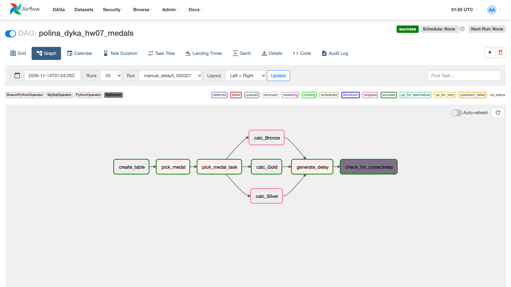
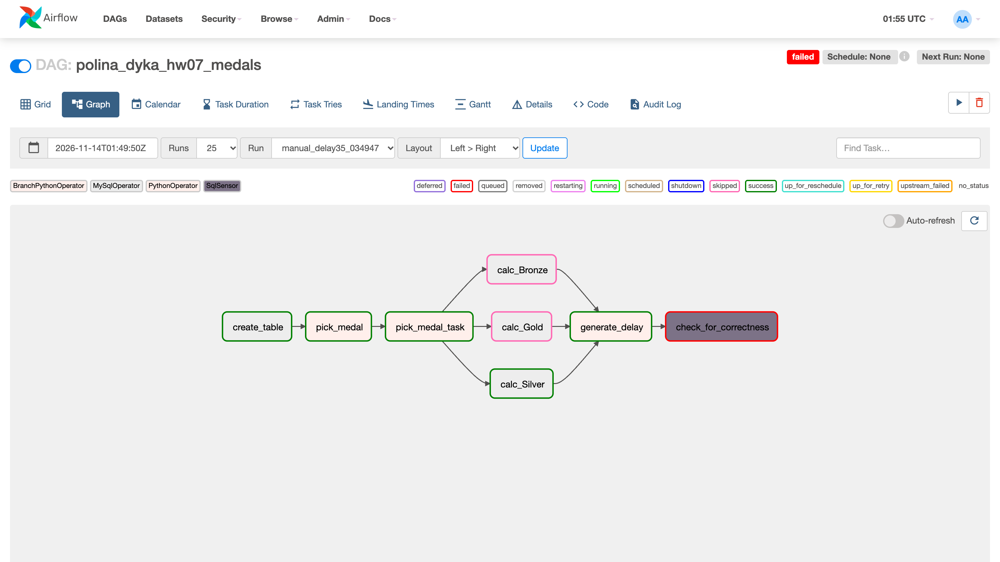
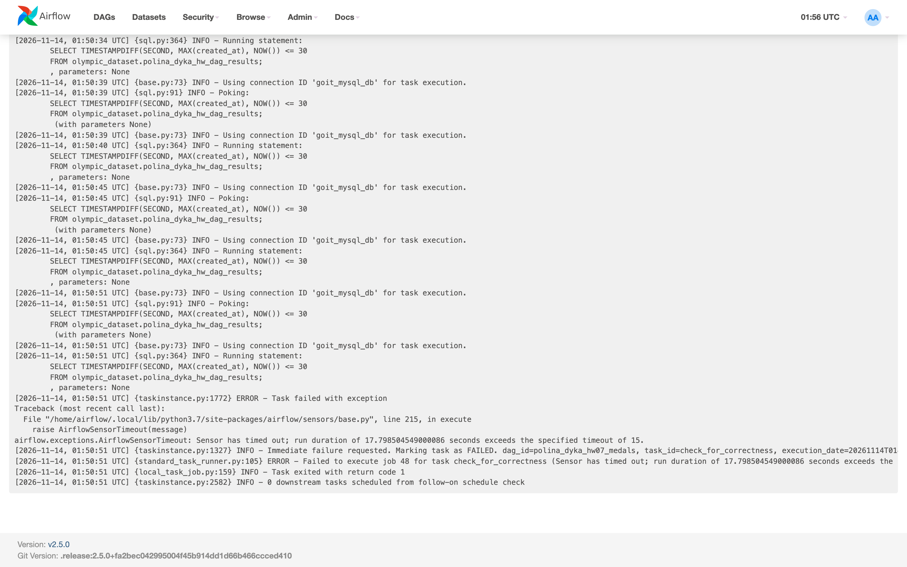
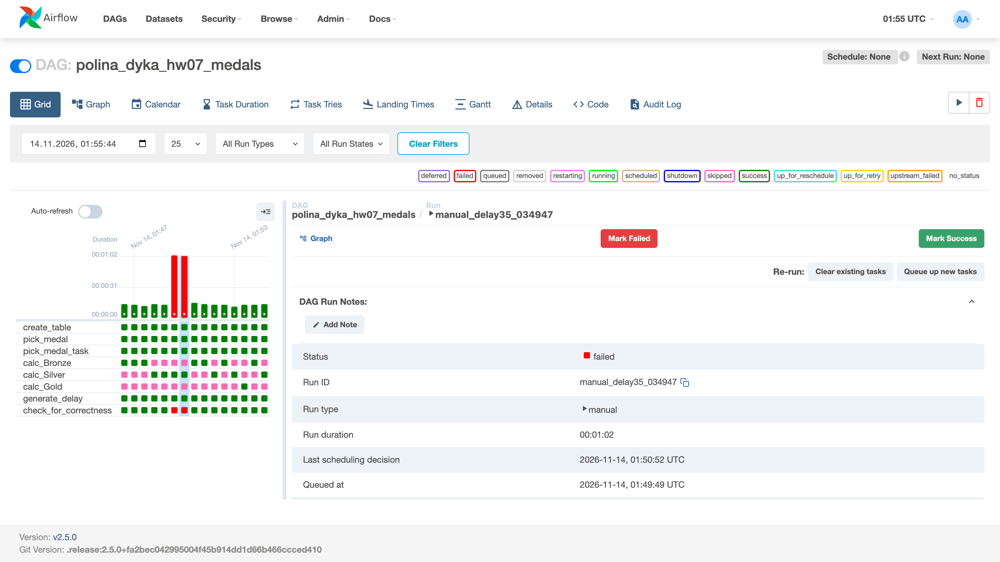
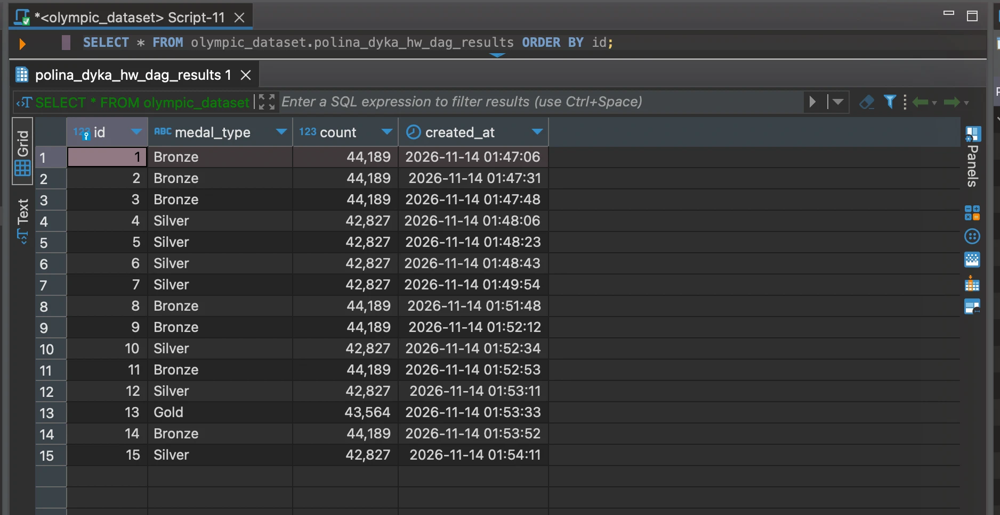

# goit-de-hw-07 — Apache Airflow

DAG `polina_dyka_hw07_medals` ([dags/polina_dyka_hw07_dag.py](dags/polina_dyka_hw07_dag.py)) випадково обирає тип медалі, рахує кількість таких записів в `olympic_dataset.athlete_event_results`, записує результат у таблицю й сенсором перевіряє, що запис свіжий.

```
create_table → pick_medal → pick_medal_task ─┬→ calc_Bronze ─┐
                                             ├→ calc_Silver ─┼→ generate_delay → check_for_correctness
                                             └→ calc_Gold ───┘
```

| # | Task | Оператор | Що робить |
|---|---|---|---|
| 1 | `create_table` | `MySqlOperator` | `CREATE TABLE IF NOT EXISTS olympic_dataset.polina_dyka_hw_dag_results` з полями `id` (AUTO_INCREMENT, PK), `medal_type`, `count`, `created_at` |
| 2 | `pick_medal` | `PythonOperator` | `random.choice(['Bronze', 'Silver', 'Gold'])`, результат іде в XCom |
| 3 | `pick_medal_task` | `BranchPythonOperator` | Читає медаль з XCom і повертає `calc_<медаль>`. Два інші завдання отримують статус `skipped` |
| 4 | `calc_Bronze` / `calc_Silver` / `calc_Gold` | `MySqlOperator` | `INSERT INTO … SELECT '<медаль>', COUNT(*), NOW() FROM athlete_event_results WHERE medal = '<медаль>'` |
| 5 | `generate_delay` | `PythonOperator` | `time.sleep(n)`. `trigger_rule=ONE_SUCCESS`: запускається, якщо одне з трьох calc-завдань успішне (два інші пропущені) |
| 6 | `check_for_correctness` | `SqlSensor` | `TIMESTAMPDIFF(SECOND, MAX(created_at), NOW()) <= 30`. Опитує кожні 5 с, через 15 с без успіху падає |

**Затримка** задається параметром запуску `delay_seconds` (за замовчуванням 5), тому для демонстрації падіння сенсора код міняти не треба: *Trigger DAG w/ config* → `{"delay_seconds": 35}`. Тоді на момент перевірки запис уже старший за 30 с, і сенсор падає з таймаутом.

`created_at` і `NOW()` в сенсорі обидва беруться з годинника MySQL, тож різниця часових поясів між Airflow і БД на перевірку не впливає.

## Запуск локально

Airflow 2.5.0 (CeleryExecutor) піднімається з [docker-compose.yaml](docker-compose.yaml) курсу. Відносно оригіналу змінено дві речі: вимкнено приклади DAG-ів (`LOAD_EXAMPLES: 'false'`) і додано змінну `AIRFLOW_CONN_GOIT_MYSQL_DB`, з якої Airflow створює підключення `goit_mysql_db`. DAG лежить у [dags/](dags/).

В образі `apache/airflow:2.5.0` для arm64 (Apple Silicon) немає драйвера `MySQLdb`, тому підключення використовує `mysql-connector-python`: пакет ставиться через `_PIP_ADDITIONAL_REQUIREMENTS`, а в URI підключення додано `?client=mysql-connector-python` (див. [.env.example](.env.example)).

```bash
cp .env.example .env        # вписати логін, пароль і хост MySQL
docker compose up airflow-init
docker compose up -d
```

UI: http://localhost:8080 (логін і пароль `airflow`).

## Скриншоти

### 1. Граф DAG: успішний запуск (затримка 5 с)

Обрано одну медаль, два інші calc-завдання пропущені, сенсор успішний:



### 2. Сенсор падає (затримка 35 с)



Лог сенсора: кожні 5 с перевірка повертає 0, після 15 с — `AirflowSensorTimeout`:



### 3. Grid: історія запусків

Різні медалі в різних запусках і червоні запуски з затримкою 35 с:



### 4. Дані в таблиці

```sql
SELECT * FROM olympic_dataset.polina_dyka_hw_dag_results ORDER BY id;
```


